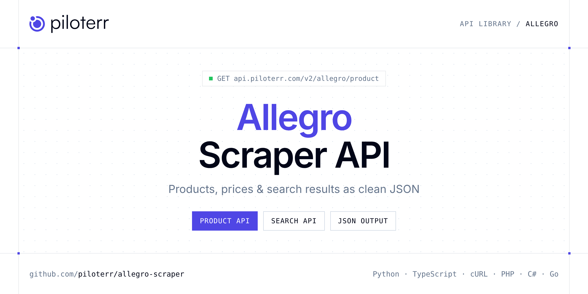

<p align="center">
  <a href="https://www.piloterr.com"></a>
</p>

# Allegro Scraper API

[](https://discord.gg/CFj3ph8aHU) [](https://app.piloterr.com) [](https://app.piloterr.com/openapi) [](LICENSE)

The **Piloterr Allegro Scraper API** lets you extract public data from Allegro as **clean, structured JSON** — no proxies, headless browsers or HTML parsing to maintain. Endpoints available in production:

- **Allegro Product API** — Allegro Product API.
- **Allegro Search API** — Allegro Search API.

Use it for price monitoring, assortment tracking, competitor analysis, product research or catalog enrichment.

| Endpoint | Path | Credits | What you get |
|---|---|---|---|
| [Allegro Product API](#allegro-product-api) | `/v2/allegro/product` | 3 | Allegro Product API. Extract full product page data from allegro.pl by URL (`/produkt/`, `/oferta/`, `/ogloszenie/`). Browser rendering, 3 credits per call. Pair with Allegro Search (3 credits) for listing discovery. |
| [Allegro Search API](#allegro-search-api) | `/v2/allegro/search` | 3 | Allegro Search API. Query product listings by keyword, optional page number, or full allegro.pl listing URL. Returns results with prices, sellers, sponsorship flags and pagination. 3 credits per call. |

## Table of contents

- [How it works](#how-it-works)
- [Allegro Product API](#allegro-product-api)
- [Allegro Search API](#allegro-search-api)
- [Code examples in other languages](#code-examples-in-other-languages)
- [Practical use cases](#practical-use-cases)
- [Why Piloterr?](#why-piloterr)
- [FAQ](#faq)
- [Related scrapers](#related-scrapers)
- [Support](#support)

## How it works

1. **Create a free Piloterr account** and copy your API key from the [dashboard](https://app.piloterr.com).
2. **Send a `GET` (or `POST`) request** to `https://api.piloterr.com/v2/...` with the header `x-api-key: YOUR_API_KEY`.
3. **Receive structured JSON** — Piloterr handles rendering, proxies, retries and parsing.

```bash
export PILOTERR_API_KEY="your-api-key"
pip install requests        # Python
# TypeScript: Node.js 18+ (native fetch), run with `npx tsx file.ts`
```

> Every endpoint accepts both `GET` (query string) and `POST` (JSON body with the same fields).

## Allegro Product API

Allegro Product API. Extract full product page data from allegro.pl by URL (`/produkt/`, `/oferta/`, `/ogloszenie/`). Browser rendering, 3 credits per call. Pair with Allegro Search (3 credits) for listing discovery.

`GET | POST https://api.piloterr.com/v2/allegro/product` · **3 credits per request** · [Full reference](https://app.piloterr.com/openapi)

### Request parameters

| Parameter | Type | Required | Description |
|---|---|---|---|
| `query` | string | ✅ | Full allegro.pl product or offer URL to extract structured PDP data. |

### Python example

```python
import json
import os
import requests

response = requests.get(
    "https://api.piloterr.com/v2/allegro/product",
    headers={"x-api-key": os.environ["PILOTERR_API_KEY"]},
    params={
        "query": "https://allegro.pl/produkt/slug-uuid?offerId=123",
    },
    timeout=60,
)
response.raise_for_status()
data = response.json()

print(json.dumps(data, indent=2, ensure_ascii=False)[:2000])
```

### TypeScript example

```typescript
type AllegroProduct = {
  sku?: string;
  url?: string;
  bars?: unknown[];
  icon?: string;
  name?: string;
  skin?: string;
  type?: number;
  brand?: unknown;
  image?: string;
  offer?: {
    id?: string;
    seo?: {
      title?: string;
      noindex?: boolean;
      nofollow?: boolean;
      canonical?: Record<string, unknown>;
      description?: string;
    };
    name?: string;
    view?: {
      url?: string;
      type?: string;
      ended?: unknown;
      future?: unknown;
      snapshot?: unknown;
      restricted?: unknown;
    };
    coins?: unknown;
    stock?: unknown;
    images?: {
      alt?: string;
      url?: string;
    }[];
    seller?: {
      id?: string;
      name?: string;
      brand?: Record<string, unknown>;
      login?: string;
      banner?: unknown;
      company?: Record<string, unknown>;
      contact?: Record<string, unknown>;
      listing?: Record<string, unknown>;
      logotype?: unknown;
      vacation?: unknown;
      descriptions?: Record<string, unknown>;
      super_seller?: unknown;
      privacy_policy?: unknown;
      representation?: unknown;
      category_listing?: Record<string, unknown>;
    };
    charity?: unknown;
    contact?: {
      id?: string;
      emails?: Record<string, unknown>[];
      phones?: Record<string, unknown>[];
    };
    product?: {
      rating?: unknown;
      reviews?: unknown;
    };
    rebates?: {
      bundles?: unknown[];
    };
    category?: {
      id?: string;
      name?: string;
      tree?: string;
    };
    delivery?: {
      summary?: Record<string, unknown>[];
    };
    location?: {
      city?: string;
      country?: string;
      province?: string;
      country_code?: string;
    };
    campaigns?: {
      summary?: unknown[];
    };
    watchlist?: {
      is_watched?: boolean;
    };
    automotive?: Record<string, unknown>;
    info_boxes?: unknown[];
    parameters?: {
      id?: unknown;
      name?: string;
      values?: Record<string, unknown>[];
    }[];
    attachments?: unknown[];
    breadcrumbs?: {
      id?: string;
      url?: string;
      name?: string;
      type?: string;
    }[];
    publication?: {
      ended_at?: unknown;
      ending_at?: string;
      starting_at?: unknown;
      availability?: unknown;
    };
    installments?: unknown;
    selling_mode?: {
      tax?: unknown;
      cart?: unknown;
      auction?: unknown;
      buy_now?: unknown;
      restricted?: unknown;
      advertisement?: Record<string, unknown>;
      one_click_buy?: unknown;
    };
    [key: string]: unknown;
  };
  price?: string;
  route?: string;
  title?: string;
  erotic?: boolean;
};

const params = new URLSearchParams({
  "query": "https://allegro.pl/produkt/slug-uuid?offerId=123",
});

const response = await fetch(`https://api.piloterr.com/v2/allegro/product?${params}`, {
  headers: { "x-api-key": process.env.PILOTERR_API_KEY! },
});
if (!response.ok) throw new Error(`Piloterr error ${response.status}: ${await response.text()}`);

const data = (await response.json()) as AllegroProduct;

console.log(JSON.stringify(data, null, 2).slice(0, 2000));
```

<details>
<summary><b>POST variant</b></summary>

```http
POST https://api.piloterr.com/v2/allegro/product
x-api-key: YOUR_API_KEY
Content-Type: application/json

{"query": "https://allegro.pl/produkt/slug-uuid?offerId=123"}
```
</details>

### Output example

Example response from the API reference, abridged — real values depend on the page you scrape.

```json
{
  "sku": "11917354378",
  "url": "https://allegro.pl/ogloszenie/obejmy-fi50-fi51-fi52-i-inne-obejma-uchwyty-slupek-11917354378",
  "bars": [],
  "icon": "https://a.allegroimg.com/original/341ba4/cb3e84504cacb8b50a0f2c505a62/illustration-small-wallet-d2280e232b",
  "name": "obejmy fi50 fi51 fi52 i inne obejma uchwyty słupek",
  "skin": "common",
  "type": 2,
  "brand": null,
  "image": "https://a.allegroimg.com/original/1109e9/c8450d474d65a25d8082ca52dbf3/obejmy-fi50-fi51-fi52-i-inne-obejma-uchwyty-slupek",
  "offer": {
    "id": "11917354378",
    "seo": {
      "title": "obejmy fi50 fi51 fi52 i inne obejma uchwyty słupek 11917354378 - Allegro.pl",
      "noindex": false,
      "nofollow": false,
      "canonical": {
        "url": "https://allegro.pl/ogloszenie/obejmy-fi50-fi51-fi52-i-inne-obejma-uchwyty-slupek-11917354378"
      },
      "description": "Kup teraz na Allegro.pl za 6 zł - obejmy fi50 fi51 fi52 i inne obejma uchwyty słupek (11917354378). Allegro.pl - Radość zakupów i bezpiec…"
    },
    "name": "obejmy fi50 fi51 fi52 i inne obejma uchwyty słupek",
    "view": {
      "url": "https://allegro.pl/ogloszenie/obejmy-fi50-fi51-fi52-i-inne-obejma-uchwyty-slupek-11917354378",
      "type": "ACTIVE",
      "ended": null,
      "future": null,
      "snapshot": null,
      "restricted": null
    },
    "coins": null,
    "stock": null,
    "images": [
      {
        "alt": "obejmy fi50 fi51 fi52 i inne obejma uchwyty słupek",
        "url": "https://a.allegroimg.com/original/1109e9/c8450d474d65a25d8082ca52dbf3/obejmy-fi50-fi51-fi52-i-inne-obejma-uchwyty-slupek"
      },
      {
        "alt": null,
        "url": "https://a.allegroimg.com/original/110924/2f2fc328416faa649198eb3b0f0d"
      }
    ],
    "seller": {
      "id": "46897551",
      "name": "artur_puscz",
      "brand": {
        "logotype": null,
        "description": null
      },
      "login": "artur_puscz",
      "banner": null,
      "company": {
        "name": "FAREX",
        "address": {},
        "verified": true,
        "representative_label": "ARTUR PUSCZ",
        "tax_identification_number": "754-201-97-61",
        "national_court_register_number": null,
        "statistical_identification_number": "532469268"
      },
      "contact": {
        "emails": [],
        "phones": [],
        "open_hours": [
          {},
          {}
        ]
      },
      "listing": {
        "url": "https://allegro.pl/uzytkownik/artur_puscz"
      },
      "logotype": null,
      "vacation": null,
      "descriptions": {
        "main": null,
        "additional": null
      },
      "super_seller": null,
      "privacy_policy": null,
      "representation": null,
      "category_listing": {
        "url": "https://allegro.pl/uzytkownik/artur_puscz/uslugi-pozostale-258984"
      }
    },
    "charity": null,
    "contact": {
      "id": "317e0f93-f02d-4af0-a90b-3f5cd155838d",
      "emails": [
        {}
      ],
      "phones": [
        {}
      ]
    },
    "product": {
      "rating": null,
      "reviews": null
    },
    "rebates": {
      "bundles": []
    },
    "category": {
      "id": "258984",
      "name": "Pozostałe",
      "tree": "navigation-pl"
    },
    "delivery": {
      "summary": [
        {}
      ]
    },
    "location": {
      "city": "Łubniany",
      "country": "Polska",
      "province": "opolskie",
      "country_code": "PL"
    },
    "campaigns": {
      "summary": []
    },
    "watchlist": {
      "is_watched": false
    },
    "automotive": {},
    "info_boxes": [],
    "parameters": [
      {
        "id": null,
        "name": "Faktura",
        "values": [
          {}
        ]
      }
    ],
    "attachments": [],
    "breadcrumbs": [
      {
        "id": "954b95b6-43cf-4104-8354-dea4d9b10ddf",
        "url": "https://allegro.pl",
        "name": "Allegro",
        "type": "DEPARTMENT"
      },
      {
        "id": "4bd97d96-f0ff-46cb-a52c-2992bd972bb1",
        "url": "https://allegro.pl/dzial/firma",
        "name": "Firma i usługi",
        "type": "DEPARTMENT"
      }
    ],
    "publication": {
      "ended_at": null,
      "ending_at": "2023-11-24T10:51:33Z",
      "starting_at": null,
      "availability": null
    },
    "installments": null,
    "selling_mode": {
      "tax": null,
      "cart": null,
      "auction": null,
      "buy_now": null,
      "restricted": null,
      "advertisement": {
        "price": {},
        "price_prefix_label": null
      },
      "one_click_buy": null
    }
  },
  "price": "6.00",
  "route": "allegro.pl/ogloszenie/:offerId",
  "title": "Metody płatności",
  "erotic": false
}
```

### Response fields

| Field | Type | Description |
|---|---|---|
| `sku` | string |  |
| `url` | string |  |
| `bars` | any[] |  |
| `icon` | string |  |
| `name` | string |  |
| `skin` | string |  |
| `type` | integer |  |
| `brand` | object |  |
| `image` | string |  |
| `offer` | object |  |
| `offer.id` | string |  |
| `offer.seo` | object |  |
| `offer.name` | string |  |
| `offer.view` | object |  |
| `offer.coins` | object |  |
| `offer.stock` | object |  |
| `offer.images[]` | object[] |  |
| `offer.seller` | object |  |
| `offer.charity` | object |  |
| `offer.contact` | object |  |
| `offer.product` | object |  |
| `offer.rebates` | object |  |
| `offer.category` | object |  |
| `offer.delivery` | object |  |
| `offer.location` | object |  |

## Allegro Search API

Allegro Search API. Query product listings by keyword, optional page number, or full allegro.pl listing URL. Returns results with prices, sellers, sponsorship flags and pagination. 3 credits per call.

`GET | POST https://api.piloterr.com/v2/allegro/search` · **3 credits per request** · [Full reference](https://app.piloterr.com/openapi)

### Request parameters

| Parameter | Type | Required | Description |
|---|---|---|---|
| `query` | string | ✅ | Search keyword or full Allegro listing URL. |
| `page` | number | — | Page number for keyword searches (default `1`). |

### Python example

```python
import json
import os
import requests

response = requests.get(
    "https://api.piloterr.com/v2/allegro/search",
    headers={"x-api-key": os.environ["PILOTERR_API_KEY"]},
    params={
        "query": "mufowa",
    },
    timeout=60,
)
response.raise_for_status()
data = response.json()

print(json.dumps(data, indent=2, ensure_ascii=False)[:2000])
```

### TypeScript example

```typescript
type AllegroSearch = {
  results?: {
    price?: number;
    title?: string;
    currency?: string;
    offer_id?: string;
    position?: number;
    image_url?: string;
    seller_id?: string;
    product_id?: string;
    listing_url?: string;
    seller_name?: string;
    is_sponsored?: boolean;
    delivery_info?: string;
  }[];
  pagination?: {
    next?: string;
    page?: number;
    per_page?: number;
    total_pages?: number;
    total_results?: number;
  };
};

const params = new URLSearchParams({
  "query": "mufowa",
});

const response = await fetch(`https://api.piloterr.com/v2/allegro/search?${params}`, {
  headers: { "x-api-key": process.env.PILOTERR_API_KEY! },
});
if (!response.ok) throw new Error(`Piloterr error ${response.status}: ${await response.text()}`);

const data = (await response.json()) as AllegroSearch;

console.log(JSON.stringify(data, null, 2).slice(0, 2000));
```

<details>
<summary><b>POST variant</b></summary>

```http
POST https://api.piloterr.com/v2/allegro/search
x-api-key: YOUR_API_KEY
Content-Type: application/json

{"query": "mufowa"}
```
</details>

### Output example

Example response from the API reference, abridged — real values depend on the page you scrape.

```json
{
  "results": [
    {
      "price": 17.84,
      "title": "ZŁĄCZKA MUFOWA ZAPRASOWYWANA PEX ALUPEX 32 x 1'' GW TYP SZCZĘK \"U\" MOSIĄDZ",
      "currency": "PLN",
      "offer_id": "13183761915",
      "position": 0,
      "image_url": "https://a.allegroimg.com/s360/116ee2/44bad5d14926a20193c6cb2d8c29/ZLACZKA-MUFOWA-ZAPRASOWYWANA-PEX-ALUPEX-32-x-1-GW-TYP-SZCZEK-U-MOSIADZ",
      "seller_id": "36900410",
      "product_id": "8d15c247-8aeb-4b82-b078-dfae9aa50931",
      "listing_url": "https://allegro.pl/oferta/zlaczka-mufowa-zaprasowywana-pex-alupex-32-x-1-gw-typ-szczek-u-mosiadz-13183761915?bi_s=ads&bi_m=productlisting…",
      "seller_name": "example",
      "is_sponsored": true,
      "delivery_info": "28,33 zł z dostawą"
    },
    {
      "price": 3.8,
      "title": "Mufa ocynkowana TICKA złączka mufowa fi 125 do rur spiro wentylacja",
      "currency": "PLN",
      "offer_id": "16509668391",
      "position": 1,
      "image_url": "https://a.allegroimg.com/s360/112b7f/92e216854e069e9f43f2adbc4c74/Mufa-ocynkowana-TICKA-zlaczka-mufowa-fi-125-do-rur-spiro-wentylacja",
      "seller_id": "48847819",
      "product_id": "6357bbc1-df4f-48ec-8e99-b346a1326f3c",
      "listing_url": "https://allegro.pl/produkt/mufa-ocynkowana-ticka-zlaczka-mufowa-fi-125-do-rur-spiro-wentylacja-6357bbc1-df4f-48ec-8e99-b346a1326f3c?offer…",
      "seller_name": "example",
      "is_sponsored": false,
      "delivery_info": "14,29 zł z dostawą"
    }
  ],
  "pagination": {
    "next": "https://allegro.pl/listing?string=mufowa&p=2",
    "page": 1,
    "per_page": 74,
    "total_pages": 13,
    "total_results": 1628
  }
}
```

### Response fields

| Field | Type | Description |
|---|---|---|
| `results[]` | object[] |  |
| `results[].price` | number |  |
| `results[].title` | string |  |
| `results[].currency` | string |  |
| `results[].offer_id` | string |  |
| `results[].position` | integer |  |
| `results[].image_url` | string |  |
| `results[].seller_id` | string |  |
| `results[].product_id` | string |  |
| `results[].listing_url` | string |  |
| `results[].seller_name` | string |  |
| `results[].is_sponsored` | boolean |  |
| `results[].delivery_info` | string |  |
| `pagination` | object |  |
| `pagination.next` | string |  |
| `pagination.page` | integer |  |
| `pagination.per_page` | integer |  |
| `pagination.total_pages` | integer |  |
| `pagination.total_results` | integer |  |

## Code examples in other languages

Ready-to-run examples live in the [`examples/`](examples) folder. Each one reads your key from the `PILOTERR_API_KEY` environment variable.

| Language | Product | Search |
|---|---|---|
| cURL (Bash) | [`product`](examples/curl/product.sh) | [`search`](examples/curl/search.sh) |
| PHP | [`product`](examples/php/product.php) | [`search`](examples/php/search.php) |
| C# | [`product`](examples/csharp/Product.cs) | [`search`](examples/csharp/Search.cs) |
| Go | [`product`](examples/go/product.go) | [`search`](examples/go/search.go) |
| Java | [`product`](examples/java/ProductExample.java) | [`search`](examples/java/SearchExample.java) |
| Ruby | [`product`](examples/ruby/product.rb) | [`search`](examples/ruby/search.rb) |
| Node.js | [`product`](examples/nodejs/product.mjs) | [`search`](examples/nodejs/search.mjs) |

## Practical use cases

- **Price monitoring** — Track prices, promotions and availability over time to react to competitors.
- **Assortment & catalog tracking** — Follow new products, delisted items and category changes.
- **Competitor analysis** — Benchmark ranges, brands and positioning across retailers.
- **Product research** — Spot best-sellers and trends from search results.
- **Catalog enrichment** — Pull titles, images and attributes into your PIM or marketplace listings.

## Why Piloterr?

- **No infrastructure** — no proxies, headless browsers or CAPTCHA solving to run yourself.
- **Structured JSON** — stable, documented fields instead of brittle HTML selectors.
- **Pay per request** — transparent credit cost per endpoint, failed requests are retried for you.
- **One API key, hundreds of sources** — Allegro plus many other e-commerce, search and company data endpoints in the [Piloterr library](https://www.piloterr.com/library).
- **Any language** — plain HTTPS + JSON, with examples for Python, TypeScript, cURL, PHP, C#, Go, Java, Ruby and Node.js.

## FAQ

### Is it legal to scrape Allegro?

Collecting publicly available data is generally allowed in many jurisdictions, but rules depend on your country, the data you collect and how you use it. Avoid personal data unless you have a lawful basis, respect the website's terms where they apply, and get legal advice for your specific use case. This is not legal advice.

### Do I need proxies or a headless browser?

No. Piloterr handles rendering, proxy rotation and retries on its side. You only send an HTTPS request with your `x-api-key` header and receive JSON.

### How much does a request cost?

Credits per call: `/v2/allegro/product` **3**, `/v2/allegro/search` **3**. See the [Piloterr website](https://www.piloterr.com) for plans.

### What data does the Allegro API return?

Each endpoint returns structured JSON: **Allegro Product** — `sku`, `url`, `bars`, `icon`, `name`, `skin`; **Allegro Search** — `results[]`, `results[].price`, `results[].title`, `results[].currency`, `results[].offer_id`, `results[].position`.

### How do I paginate Allegro results?

Use the `page` parameter and keep requesting while the response indicates more results.

### Which languages are supported?

Any language that can make an HTTP request. This README shows Python and TypeScript; the [`examples/`](examples) folder contains cURL, PHP, C#, Go, Java, Ruby and Node.js.

## Related scrapers

- [About You Scraper API](https://github.com/piloterr/aboutyou-scraper)
- [Action Scraper API](https://github.com/piloterr/action-scraper)
- [Aldi Scraper API](https://github.com/piloterr/aldi-scraper)
- [Alibaba Scraper API](https://github.com/piloterr/alibaba-scraper)
- [AliExpress Scraper API](https://github.com/piloterr/aliexpress-scraper)
- [Amazon Scraper API](https://github.com/piloterr/amazon-scraper)
- [All Piloterr scrapers on GitHub](https://github.com/piloterr)

## Support

- 💬 Join the [Piloterr Discord](https://discord.gg/CFj3ph8aHU) to ask questions and share what you build.
- 📚 Browse the [API reference (OpenAPI)](https://app.piloterr.com/openapi) and the [Piloterr library](https://www.piloterr.com/library).
- 🔑 [Get your API key](https://app.piloterr.com).

---

<p align="center">
  <a href="https://www.piloterr.com">
    <picture>
      <source media="(prefers-color-scheme: dark)" srcset="images/logo-dark.svg">
      
    </picture>
  </a>
  <br>
  <sub>Built by <a href="https://www.piloterr.com">Piloterr</a> — web scraping APIs for e-commerce, search, real estate and more, one API key.</sub>
</p>

<sub>Allegro is a trademark of its respective owner. This repository is not affiliated with or endorsed by Allegro. Examples are released under the MIT license.</sub>
